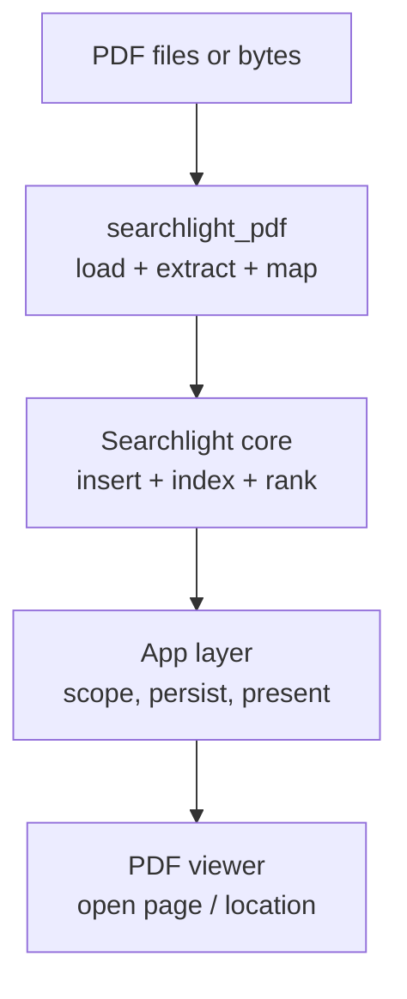
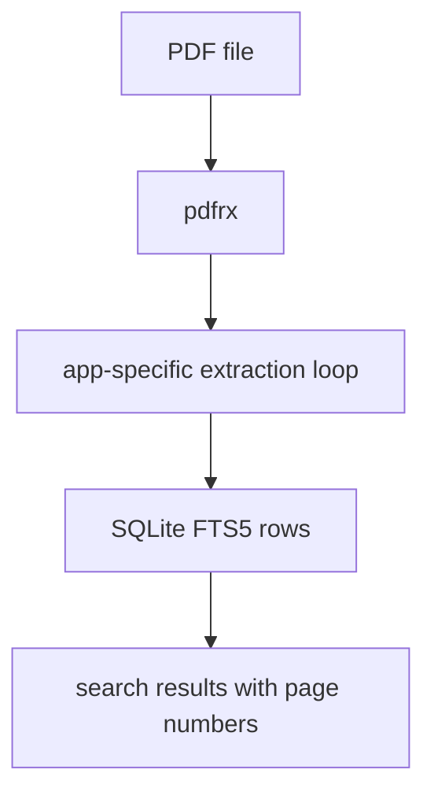
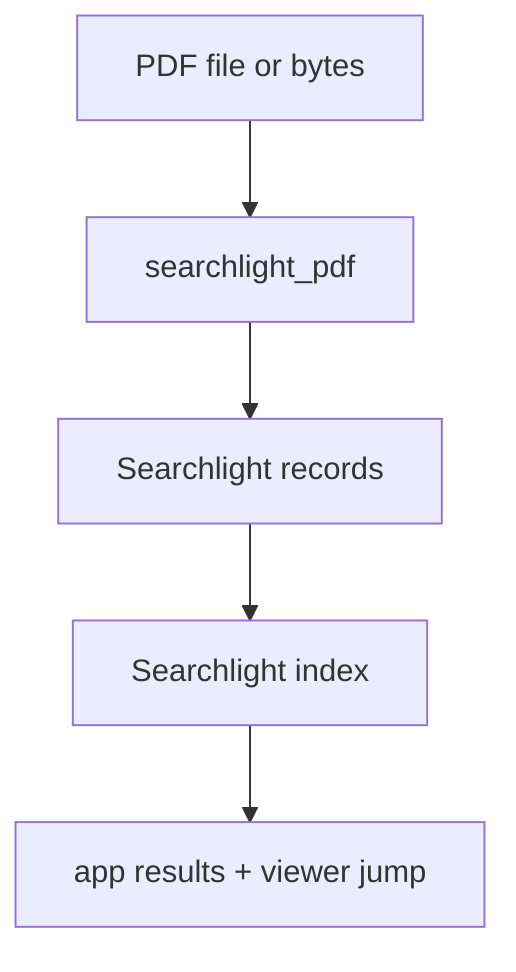

# Package Spec

## Goal

`searchlight_pdf` should convert PDF content into Searchlight-ready records
without making PDF support a core-package responsibility.

## Problem Statement

Searchlight already does well with structured text records. The gap is not
search ranking or index creation; the gap is turning PDF source material into a
Searchlight-friendly corpus.

That means `searchlight_pdf` exists to answer:

- how do we load PDF files or bytes?
- how do we extract text reliably enough for search?
- how do we preserve page attribution?
- how do we map that extracted output into Searchlight-ready records?

It does not exist to replace either the PDF engine or the search engine.

## First Consumer: Tomekeeper

The first installation target is Tomekeeper, a tabletop RPG PDF library app.

That concrete use case shapes the package:

- users may have 20, 30, or 50 PDFs
- search may target:
  - one current book
  - a selected subset or group
  - the whole library
- search hits must route back to a specific PDF page cleanly
- rulebook UX values page attribution more than abstract semantic parsing

This is why page-level indexing is the most practical first record strategy.

## Boundary Diagram



Responsibility split:

- `searchlight_pdf`: PDF in, structured records out
- `searchlight`: records in, ranked search out
- app code: decide what corpus to index and how a result opens in the viewer

## Current Tomekeeper Path vs Target Package Path

Today, Tomekeeper already has an app-specific PDF search path:



The target reusable path is:



The difference is not that Tomekeeper suddenly learns how to read PDFs. The
difference is that the extraction and record-mapping logic becomes reusable,
documented, and aligned with the Searchlight package family instead of living
only inside one app.

## What `searchlight_pdf` Is Not

It is important to be explicit here.

`searchlight_pdf` is not:

- a replacement for `pdfrx_engine`
- a replacement for `searchlight`
- a PDF viewer package
- an OCR package
- a snippet/highlight renderer
- a universal ingestion umbrella for every file type

The package sits between raw PDFs and Searchlight.

## Why This Should Not Be A `SearchlightPlugin`

Current evidence points away from the create-time plugin system and toward the
companion-package pattern already used by `searchlight_highlight` and
`searchlight_parsedoc`.

Reasoning:

- PDF ingestion is fundamentally async:
  - load files or bytes
  - iterate pages
  - extract text
  - possibly do background or import-time work
- Searchlight plugins are the wrong abstraction level for this job:
  - they are about core component replacement and lifecycle hooks
  - they make restore compatibility depend on plugin order and component IDs
  - they are not the natural home for a document-extraction workflow
- The existing Searchlight ecosystem already models similar concerns as helper
  packages rather than `SearchlightPlugin` objects

Decision:

- `searchlight_pdf` should be a companion/helper package, not a
  `SearchlightPlugin`
- if we ever expose convenience helpers that fill a Searchlight database, those
  helpers should still live above core rather than inside the plugin graph

## V1 Responsibilities

- accept PDF input from bytes and/or local files
- extract page text
- preserve document and page attribution metadata
- map extracted output into Searchlight-ready records
- document how app code maps search hits back into a PDF viewer

## V1 Non-Goals

- PDF rendering widgets
- OCR
- guaranteed text geometry APIs
- in-view highlight rendering
- replacing `searchlight_highlight`
- replacing `searchlight_parsedoc`

## How This Differs From `pdfrx_engine`

This came up directly in discussion and is worth pinning down.

`pdfrx_engine` is a PDF engine. It knows how to:

- open PDFs
- expose document/page APIs
- extract text
- support rendering-oriented and text-search-oriented primitives

`searchlight_pdf` should be an adapter layer above a PDF engine. It knows how
to:

- choose a stable extraction contract for Searchlight consumers
- normalize extracted PDF output into typed Dart models
- preserve Searchlight-relevant metadata such as `documentId`, `page`, and
  `sourcePath`
- map those models into Searchlight-ready records
- optionally bulk-populate a Searchlight database with a chosen record strategy

Short version:

- `pdfrx_engine` = "how do I read this PDF?"
- `searchlight_pdf` = "how do I turn PDFs into Searchlight records?"
- `searchlight` = "how do I index and rank those records?"

## Proposed Public API Shape

Unlike `searchlight_parsedoc`, PDF does not need to follow an audited upstream
public API. So the package should optimize for a clear typed Dart surface first.

### 1. Extraction APIs

Preferred top-level entry points:

- `parsePdfBytes(...)`
- `parsePdfFile(...)`

Recommended options object:

- `PdfParseOptions`

This keeps the source contract explicit and avoids the ambiguous
`parseFile(data, fileType)` shape used in parsedoc for HTML/Markdown parity.

Recommended overload philosophy:

- explicit names over overloaded file-type switches
- `parsePdfBytes(...)` as the baseline cross-platform entry point
- `parsePdfFile(...)` as a VM-only convenience helper
- no remote-download helper in v1; apps should fetch bytes themselves, then
  call `parsePdfBytes(...)`
- document any backend bootstrap/runtime caveats explicitly if the chosen
  engine requires PDFium/cache-directory initialization before extraction

### 2. Typed Extraction Model

Recommended typed model:

- `ParsedPdfDocument`
- `ParsedPdfPage`

Recommended minimum fields:

#### `ParsedPdfDocument`

- `sourcePath`
- `sourceName`
- `title`
- `pageCount`
- `pages`
- `metadata`

#### `ParsedPdfPage`

- `pageNumber`
- `pageLabel`
- `text`
- `metadata`

`metadata` should remain a generic extension bag so later geometry data can be
added without committing v1 to a geometry contract.

V1 invariants:

- `pageNumber` is 1-based
- pages are ordered by ascending page number
- `pageCount == pages.length`
- empty-text pages are still represented
- `title` is nullable
- `sourcePath` is nullable for byte-based parsing

Recommended model philosophy:

- page-oriented first
- viewer-agnostic
- compatible with both one-book and many-book corpora
- safe to enrich later without breaking the initial contract

### 3. Searchlight Mapping APIs

Recommended mapper classes:

- `SearchlightPdfPageRecordMapper`
- optional later: `SearchlightPdfChunkRecordMapper`
- optional but lower-priority: `SearchlightPdfDocumentRecordMapper`

Default page mapper output should look like:

```dart
{
  'id': 'rules-p12',
  'documentId': 'rules',
  'page': 12,
  'title': 'Rules Reference',
  'content': 'Extracted text from page 12...',
  'sourcePath': '/books/rules.pdf',
}
```

This matches the Searchlight app-integration guidance and keeps result-to-viewer
navigation simple.

Identity ownership:

- parsing stays source-oriented
- the page mapper accepts caller-owned `documentId`
- v1 should not let both the parse layer and the mapper invent application
  identity independently

Recommended mapper philosophy:

- mappers should be stateless
- default mapper should choose boring, explicit field names
- IDs should be deterministic when the app supplies deterministic document IDs
- page attribution must survive every mapper strategy

Document-level mapping is lower priority because it weakens page routing for the
first RPG-book use case. Chunk-level mapping is useful later, but page-level
mapping is the safest default.

### 4. Convenience Searchlight Helpers

Do not ship a population helper in v1.

Reasoning:

- parse APIs and mappers are enough for the first stable public surface
- helper write semantics become ambiguous too quickly once failure handling and
  identity injection are involved
- it is better to add a helper later than to ship one before its exact contract
  is clear

If a later helper is added, it should use explicit names such as
`populatePages(...)` or `populateChunks(...)` rather than a generic
`populate(...)`.

## Recommended Record Shape

Current root docs point toward a page-level Searchlight shape like:

```dart
{
  'id': 'rules-p12',
  'documentId': 'rules',
  'page': 12,
  'title': 'Rules Reference',
  'content': 'Extracted text from page 12...',
}
```

Additional optional metadata may include:

- `sourcePath`
- `sourceName`
- `pageLabel`
- `section`
- `geometry`

Only schema-declared fields should be relied on for indexing, filtering,
sorting, faceting, or grouping.

## Search Scope Ownership

Search scope belongs to app code, not to `searchlight_pdf`.

That means the package should not try to decide:

- whether the app indexes one PDF or many
- whether the corpus is "current shelf" or "whole library"
- whether the app keeps one Searchlight database per collection or one global
  database with `documentId` filters

The package should only guarantee that the mapped records preserve enough
metadata for the app to support any of those choices.

For Tomekeeper, that likely means:

- `documentId` is always present
- `page` is always present
- `title` is present when derivable
- `sourcePath` or equivalent source identity is preserved when available

## Tomekeeper Index Topology

For Tomekeeper's likely library size and UX, there are three realistic search
topologies:

### 1. One Global Index

One Searchlight database contains all page records for all indexed PDFs.

Recommended schema additions:

- `documentId`
- `page`
- optional `groupId` or `collectionId`

Pros:

- simplest initial architecture
- easiest cross-book search
- no duplicate page records across scopes
- app can scope search with filters instead of switching databases

Cons:

- one larger snapshot instead of several smaller ones
- any full rebuild touches the shared corpus

### 2. Per-Group Snapshots

One Searchlight database per shelf, campaign, or collection.

Pros:

- smaller scoped snapshots
- simple restore for strongly separated collections

Cons:

- harder cross-group search
- more snapshot management
- possible duplication if one PDF belongs to multiple groups

### 3. Hybrid

A global corpus plus selected scoped snapshots.

Pros:

- potentially best later-stage optimization

Cons:

- highest operational complexity
- not justified before real measurements

### Recommended First Topology

Start with one global index and use filters for scope.

That fits Tomekeeper best because:

- it keeps the first implementation simple
- it supports one-book, selected-group, and whole-library search using the same
  corpus
- it lets the app evolve its grouping model without changing the extraction
  layer

Per-group snapshots can be revisited later if real startup or memory data says
they are worthwhile.

## Rollout Strategy For Tomekeeper

The safest adoption path is coexistence first, replacement later.

Recommended rollout:

1. prototype `searchlight_pdf` + Searchlight against the same imported PDFs
2. keep Tomekeeper's current SQLite FTS path intact during evaluation
3. compare:
   - search quality
   - startup time after snapshot restore
   - indexing time
   - memory footprint
4. only replace the current search engine if the Searchlight path is clearly
   better or strategically more useful

This avoids forcing a migration before the extraction and snapshot story is
proven on real RPG libraries.

## Integration With Other Searchlight Packages

### `searchlight`

Required dependency. `searchlight_pdf` should produce records designed to be
inserted directly into a `Searchlight` database.

`searchlight` remains responsible for:

- `insert(...)`
- index creation
- BM25 / QPS / PT15 scoring
- filtering, sorting, grouping, and facets
- persistence / restore

Important architectural point:

Searchlight is the package that owns BM25 and index creation. `searchlight_pdf`
should never try to reimplement ranking logic or invent a parallel query
engine.

### `searchlight_highlight`

Optional companion after search. A common flow is:

1. extract PDF text into records
2. index/search with `searchlight`
3. render snippets or match ranges with `searchlight_highlight`
4. map the selected hit back to a page in the PDF viewer

Important rule:

- `searchlight_pdf` should not depend on `searchlight_highlight`
- interoperability should happen through record shape conventions, especially a
  searchable `content` field and app-level page attribution metadata

`searchlight_highlight` is still the right package for:

- excerpts
- HTML `<mark>` output
- string offset match ranges after search

That makes the relationship sequential, not circular:

1. `searchlight_pdf` extracts and maps
2. `searchlight` indexes and searches
3. `searchlight_highlight` helps render the matched text after search

### `searchlight_parsedoc`

No hard dependency is planned. It remains a separate HTML/Markdown extraction
package. Shared mapping conventions are acceptable where useful, but the PDF
package should not depend on parsedoc to do PDF work.

Recommended relationship to parsedoc:

- reuse naming conventions where they help
- reuse the broad package-family pattern of:
  - parse into a typed model
  - map into Searchlight-ready records
- do not share parser internals or model classes

Why not depend on parsedoc:

- parsedoc models document structure as blocks/tags/paths
- PDF extraction is page-oriented first, not DOM-oriented
- forcing PDF through parsedoc would blur package boundaries and make both APIs
  less clear

Direct answer to the design question:

- do not enhance parsedoc with PDF extraction in v1
- keep PDF as a sibling package
- share family conventions, not implementation ownership

If a future umbrella ingestion package is ever warranted, that should sit above
both `searchlight_parsedoc` and `searchlight_pdf` rather than forcing one to
subsume the other.

## Design Principles

- extraction concern, not core-engine concern
- docs-first API design before implementation
- search-first before rendering-first
- preserve attribution and future extension points
- avoid promising geometry or viewer integration until proven

## Open Questions That Still Matter

These remain valid and should stay visible in the spec:

- Is page-only indexing sufficient for real RPG books, or do we quickly need
  chunk helpers?
- Can we reliably derive a document title from PDF metadata, outline, filename,
  or only app-provided values?
- How much geometry metadata can we preserve without making the v1 contract too
  fragile?
- Should convenience helpers land in v1, or should the first release stay
  parse-plus-map only?
- Do we want one default mapper only, or page and chunk mappers together in the
  first public release?

## Decision Summary

Current best decisions from the design discussion:

1. Keep `searchlight_pdf` separate from `searchlight_parsedoc`.
2. Use a PDF engine such as `pdfrx_engine` underneath instead of embedding PDF
   concerns into Searchlight core.
3. Keep `searchlight_pdf` extraction-first, not viewer-first.
4. Do not model PDF ingestion as a `SearchlightPlugin`; keep it as a
   companion/helper package.
5. Let Searchlight own indexing and BM25/QPS/PT15 ranking.
6. Let `searchlight_highlight` remain the post-search rendering helper.
7. Start with page-level records and a page-attributed extraction model.
8. Do not ship a convenience population helper in v1.
9. Start Tomekeeper with one global index plus scope filters.
10. Revisit chunking only after page-level search is proven on real Tomekeeper
   books.

## Recommended V1 API Decision

The clearest V1 public surface is:

1. `parsePdfBytes(...)`
2. `parsePdfFile(...)`
3. `ParsedPdfDocument` / `ParsedPdfPage`
4. `SearchlightPdfPageRecordMapper`

That gives Tomekeeper and other apps a predictable pipeline:

1. choose PDF scope in app code
2. parse PDFs with `searchlight_pdf`
3. map pages into Searchlight-ready records with a caller-owned `documentId`
4. insert them into `searchlight`
5. optionally pass matched `content` strings into `searchlight_highlight`
